<!--
  Profile README · Lê Huy Hồng Nhật
  Every visual below is a self-made animated SVG in assets/{dark,light}/, generated by assets/build.py
  (python3 assets/build.py — standard library only). Edit the data blocks in build.py, re-run, commit.
-->

<picture>
  <source media="(prefers-color-scheme: dark)" srcset="assets/dark/hero.svg">
  <source media="(prefers-color-scheme: light)" srcset="assets/light/hero.svg">
  
</picture>

<picture>
  <source media="(prefers-color-scheme: dark)" srcset="assets/dark/ticker.svg">
  <source media="(prefers-color-scheme: light)" srcset="assets/light/ticker.svg">
  
</picture>

  

<picture>
  <source media="(prefers-color-scheme: dark)" srcset="assets/dark/whoami.svg">
  <source media="(prefers-color-scheme: light)" srcset="assets/light/whoami.svg">
  
</picture>

  

<picture>
  <source media="(prefers-color-scheme: dark)" srcset="assets/dark/mode-agent.svg">
  <source media="(prefers-color-scheme: light)" srcset="assets/light/mode-agent.svg">
  
</picture>

<picture>
  <source media="(prefers-color-scheme: dark)" srcset="assets/dark/mode-alpha.svg">
  <source media="(prefers-color-scheme: light)" srcset="assets/light/mode-alpha.svg">
  
</picture>

<picture>
  <source media="(prefers-color-scheme: dark)" srcset="assets/dark/stack.svg">
  <source media="(prefers-color-scheme: light)" srcset="assets/light/stack.svg">
  
</picture>

  

<picture>
  <source media="(prefers-color-scheme: dark)" srcset="assets/dark/section-repos.svg">
  <source media="(prefers-color-scheme: light)" srcset="assets/light/section-repos.svg">
  
</picture>

<a href="https://github.com/LeHuyHongNhat/docs-skills"><picture><source media="(prefers-color-scheme: dark)" srcset="assets/dark/project-1.svg"><source media="(prefers-color-scheme: light)" srcset="assets/light/project-1.svg"></picture></a>
<a href="https://github.com/LeHuyHongNhat/Sentiment_Analysis_Using_PhoBert_Trained"><picture><source media="(prefers-color-scheme: dark)" srcset="assets/dark/project-2.svg"><source media="(prefers-color-scheme: light)" srcset="assets/light/project-2.svg"></picture></a>

  

<picture>
  <source media="(prefers-color-scheme: dark)" srcset="assets/dark/section-contact.svg">
  <source media="(prefers-color-scheme: light)" srcset="assets/light/section-contact.svg">
  
</picture>

<a href="mailto:nhat050403@gmail.com"><picture><source media="(prefers-color-scheme: dark)" srcset="assets/dark/contact-email.svg"><source media="(prefers-color-scheme: light)" srcset="assets/light/contact-email.svg"></picture></a>
<a href="https://linkedin.com/in/lenhat543-it"><picture><source media="(prefers-color-scheme: dark)" srcset="assets/dark/contact-linkedin.svg"><source media="(prefers-color-scheme: light)" srcset="assets/light/contact-linkedin.svg"></picture></a>

  

<picture>
  <source media="(prefers-color-scheme: dark)" srcset="assets/dark/footer.svg">
  <source media="(prefers-color-scheme: light)" srcset="assets/light/footer.svg">
  
</picture>

<b>Plain-text résumé</b> (screen readers, ATS, copy-paste)

 

**Lê Huy Hồng Nhật** — AI Engineer · AI Quant Researcher · Hanoi, Vietnam

AI Engineer working on evaluation and deployment of agentic systems, and part-time quant researcher
(Global Rank 5th, AI Alpha Competition 2.0).

**AI Engineer**
- Designs layered evaluation for an agentic platform: functional and integration suites graded blind by human testers, plus a golden set scored by an LLM-as-a-judge as a regression gate on every harness change.
- Traces agent failures end-to-end with Langfuse and turns them into skill, prompt and harness fixes.
- Reads eval results for systemic causes and proposes the architecture changes that remove them.
- Forward-deploys the platform with enterprise clients and turns field feedback into product decisions.

**Quant Researcher (part-time)**
- Global Rank 5th and Rank 1st in Vietnam, AI Alpha Competition 2.0, out of ~10,000 participants.
- Built an end-to-end automated alpha-building system: hypothesis-driven expression generation, operator-usage tracking, simulation, filtering.
- Enforced liquidity and tradability constraints (liquid universes, turnover, coverage) inside the pipeline.
- Designed a selection model that ranks submissions by predicted out-of-sample performance and low correlation to the existing pool.

**AI Engineer Intern** · CNN training (VGG, ResNet) and data pipelines for image classification. 
**AI Engineer Intern** · RAG support chatbot (LangChain, OpenAI) served by FastAPI. 
**PTIT** — Engineer's Degree in Information Technology.

Contact: [nhat050403@gmail.com](mailto:nhat050403@gmail.com) · [linkedin.com/in/lenhat543-it](https://linkedin.com/in/lenhat543-it)

